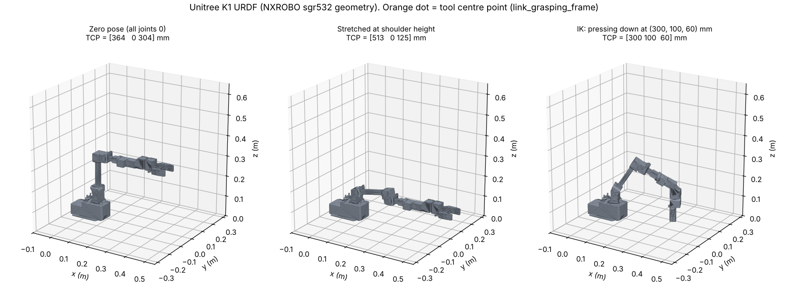

# k1_description

ROS 2 URDF and meshes for the **Unitree K1** arm (6 DOF + parallel gripper). `k1_web`'s bringup loads it into `robot_state_publisher`, so `/tf` and RViz follow the real arm.



## Where the model comes from

The K1 is the **NXROBO Sagittarius** arm (model **sgr532**) sold as a Go1 EDU accessory. The evidence:

- The [Unitree-K1-SDK](https://github.com/T-K-233/Unitree-K1-SDK) driver's `setup.py` describes it as the *"Unitree K1 (Sagittarius) robotic arm"*, and its functions are ports of NXROBO's `CSDarmCommonSerial` class.
- Both use the same serial protocol: `0x55 0xAA` header, `0x7D` terminator, the same command IDs, 1 Mbaud, and angles sent as degrees × 10.
- The model name **sgr532** matches the K1's **532 mm** listed reach. Measured in this URDF, the outermost point of the stretched arm is 532 mm from joint 1's axis.

Kinematics, inertias, joint limits and meshes come from NXROBO's [`sagittarius_descriptions`](https://github.com/NXROBO/sagittarius_ws) (BSD-3-Clause, see `LICENSE.NXROBO`). Forward kinematics of this package match the original exactly over 2,000 random poses.

## What changed from NXROBO's original

| Change | Why |
| --- | --- |
| ROS 1 `<transmission>` tags removed | Not used in ROS 2. Motion goes through `k1_web`'s actions, not ros2_control (see below) |
| Link names have an optional `prefix` (default none) instead of `sgr532/` | ROS 2 convention; allows multiple arms |
| `joint_gripper_right` mimics `joint_gripper_left` | One gripper command, matching the single gripper servo |
| Removed the inertia on `link_grasping_frame` | Upstream had a stray 1.55 kg mass at −0.29 m on a frame link, which would corrupt dynamics or Gazebo |
| Effort limits set to 4.4 / 8.3 N·m | Replaces the 100 N·m placeholder (see assumptions) |
| Optional `world` mount frame with `mount_xyz` / `mount_rpy` | Place the arm on the bench plate |

## Joints

Joint order and sign convention match the Unitree-K1-SDK driver **1:1** (radians, no per-joint sign flips). NXROBO's ROS driver also passes angles straight through.

| SDK index | SDK name | URDF joint | Axis | Limits (rad) |
| --- | --- | --- | --- | --- |
| 0 | shoulder_pan | joint1 | −z | −2.0 … 2.0 |
| 1 | shoulder_lift | joint2 | −y | −1.57 … 1.4 |
| 2 | elbow_flex | joint3 | −y | −1.48 … 1.8 |
| 3 | wrist_roll | joint4 | −x | −2.9 … 2.9 |
| 4 | wrist_flex | joint5 | −y | −1.8 … 1.6 |
| 5 | gripper_roll | joint6 | −x | −3.1 … 3.1 |
| 6 | gripper | joint_gripper_left (+ mimic right) | prismatic | −0.034 … 0 m (0 = open) |

Because the axes are negative, **negative joint2 leans the arm forward**, **positive joint3 lifts the forearm**, **negative joint5 tips the wrist down**, and **negative joint1 turns toward +y**.

Useful frames: `base_link` (mount), `link_grasping_frame` (tool centre point between the fingers), `usb_cam_link` (wrist camera mount).

## Usage

It's built with the rest of the workspace (`colcon build --base-paths ~/Downloads/robot_arm_vla_ros2/ros2`).

```bash
# the live arm: robot_state_publisher is part of the bringup; add RViz
ros2 launch k1_web k1_bringup.launch.py rviz:=true

# place the arm on the bench plate (metres, radians, relative to "world")
ros2 launch k1_web k1_bringup.launch.py mount_xyz:="0.30 -0.10 0.0" mount_rpy:="0 0 1.5708"

# just the model, with joint sliders (no arm)
ros2 launch k1_description display.launch.py
```

Non-ROS tools (PyBullet, MuJoCo import, Isaac, `yourdfpy`): use `urdf/k1_standalone.urdf`, which has relative mesh paths. It is generated from the xacro, so edit the xacro and regenerate it.

## Real hardware

`k1_driver_py` publishes `joint_states` with these joint names. The gripper is converted from the servo value to finger metres with `unitree_k1_sdk.gripper_finger_position`.

The original package also had a ros2_control setup. It's left out here on purpose. ros2_control would be a second path to the motors that bypasses `k1_web`'s limits, speed limit and STOP. Instead, `k1_web` serves the same action names a ros2_control setup would (`arm_controller/follow_joint_trajectory`, `gripper_controller/gripper_cmd`), so a MoveIt config can still target them.

## Assumptions and things to verify on the real arm

1. **Joint directions.** Command each joint +0.2 rad alone and check that RViz moves the same way. NXROBO's driver needs no sign flips, and the K1 uses the same protocol, but confirm before trusting IK.
2. **Zero pose.** At all-zeros the arm should stand as in the first image: upper arm vertical, forearm horizontal pointing forward. If not, the K1's homing differs and offsets are needed.
3. **Effort limits.** Which two joints carry the 85 kg·cm servos is undocumented. Shoulder lift and elbow are assumed. Effort is unused by position control.
4. **Gripper scale.** NXROBO's driver uses finger metres ≈ −servo_raw × 0.026 / 900. Calibrate against the real fingers.
5. **SDK gripper bug** (fixed in this repo's `unitree_k1_sdk`). `set_gripper_rad()` computed `value = rad / 2.0944` but then called `set_gripper(1.0 - rad)` instead of `1.0 - value`.
6. **Velocity limits** (3.14 rad/s) are NXROBO's published values. For bench work, run much slower.
